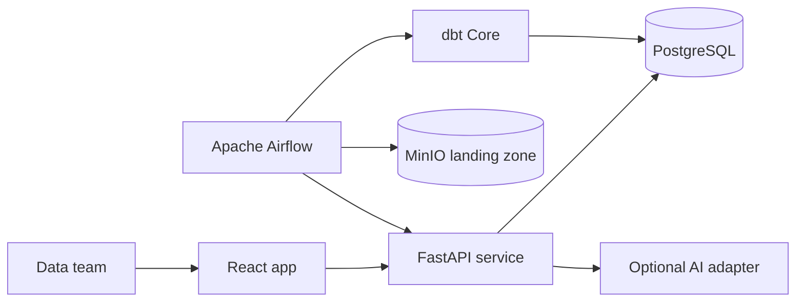

# DataHarbor

**Data reliability for small analytics teams.** DataHarbor gives one place to see pipeline runs, dataset lineage, freshness and failed quality checks, and shows which downstream datasets a broken upstream source affects.

> **Status:** early development, following a 12-week roadmap (see below). The project uses only synthetic data and local services.

## The problem

Small analytics teams run scheduled transformations, but when something breaks they have to piece together:

- which run failed and why
- whether a dataset is stale or failed a quality check
- which downstream tables and reports are affected
- how to safely re-run, or backfill, the missing data

DataHarbor answers these questions with lineage, quality rules and a safe backfill workflow.

## Who it's for

- **Data engineers:** run and troubleshoot ingestion and orchestration
- **Analytics engineers:** build and test dbt models
- **Data consumers:** check whether the data they rely on is fresh and trustworthy
- **Platform admins:** manage workspaces, permissions and operations

## Demo workflow

1. Load sample orders and payments data
2. Schedule ingestion
3. Transform staging tables with dbt
4. Trigger a failing schema or quality check
5. Trace the affected downstream datasets
6. Review a proposed fix
7. Replay a backfill safely

## Planned features

- Dataset and pipeline registry
- Synthetic CSV/JSON source connectors
- Airflow orchestration and run history
- dbt model builds and test results
- Column-level metadata and dataset lineage
- Freshness and data-quality rule engine
- Incident and alert inbox
- Backfill preview and approval
- AI-assisted run summaries that cite the actual logs
- Runbooks and an operational dashboard

## Tech stack

| Layer | Technology |
|---|---|
| Frontend | React, TypeScript |
| API | Python, FastAPI |
| Orchestration | Apache Airflow |
| Transformations | dbt Core |
| Database | PostgreSQL |
| Object storage | MinIO |
| Cache | Redis |
| Local environment | Docker Compose |
| CI | GitHub Actions |

## Architecture

The API is the authoritative record of datasets, runs and incidents. Airflow orchestrates ingestion and dbt builds; results, lineage and quality outcomes flow back into PostgreSQL. Raw files land in MinIO.



### Planned repository layout

```text
dataharbor/
├── apps/web/              # React frontend
├── services/api/          # FastAPI service
├── services/worker/       # background jobs
├── pipelines/             # Airflow DAGs and dbt project
├── packages/fixtures/     # synthetic source data
├── infra/compose/         # local services
├── tests/                 # integration and end-to-end tests
└── docs/                  # architecture decisions and progress notes
```

## Design rules

- Re-running ingestion or a backfill never duplicates data.
- Backfills are previewed and approved before they run.
- Lineage and quality results come from real run metadata, not guesses.
- AI summaries must cite real log lines and never take action on their own.
- Permissions are enforced on the server for every workspace.

## Roadmap

| Weeks | Focus |
|---|---|
| 1–2 | Local data platform, fixtures, workspace permissions and dataset registry |
| 3–5 | Ingestion contracts, landing zone, Airflow DAGs, run tracking and dbt models |
| 6–8 | Freshness and quality engine, lineage graph, failure incident workflow |
| 9–10 | Backfill preview and idempotent execution; AI run summaries with citations |
| 11–12 | Scale, recovery and security testing; deployment and demo |

## Getting started

Setup instructions will be added once the first services are in place.
